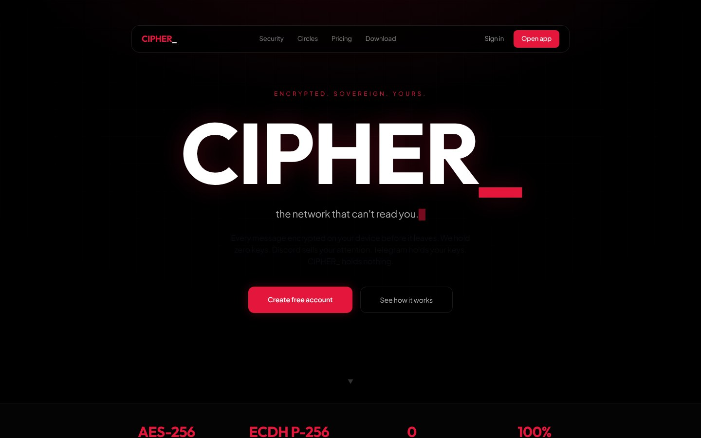
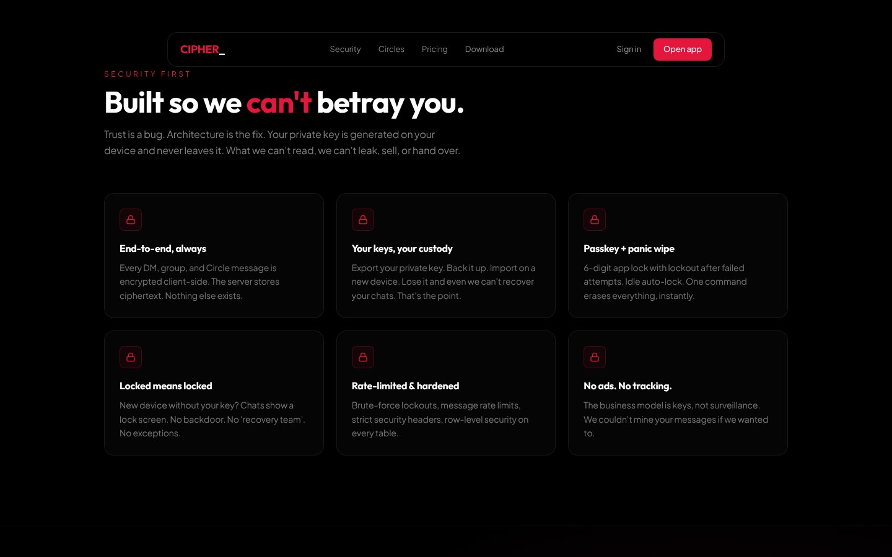
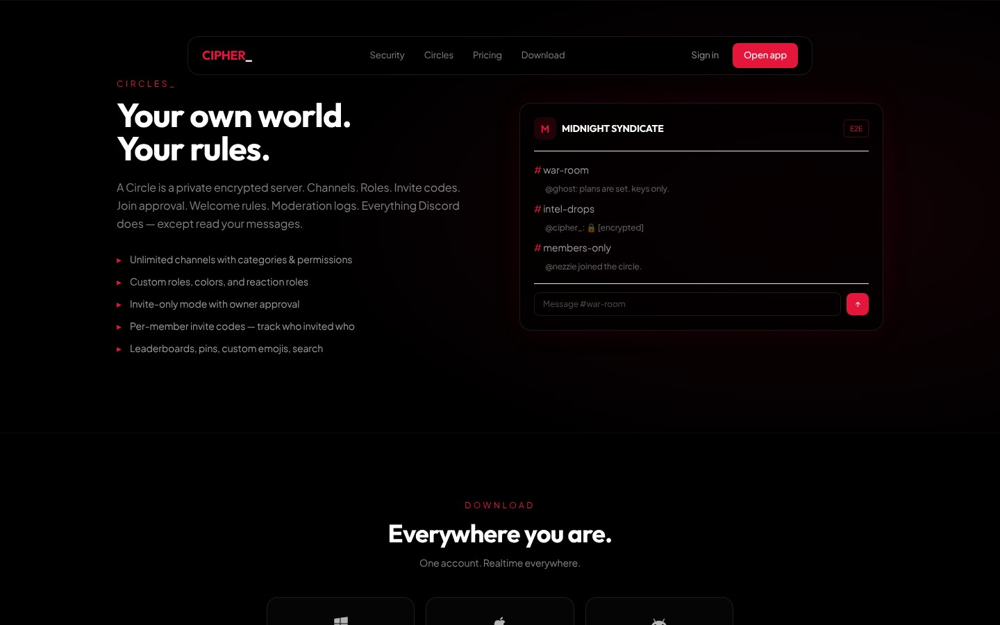
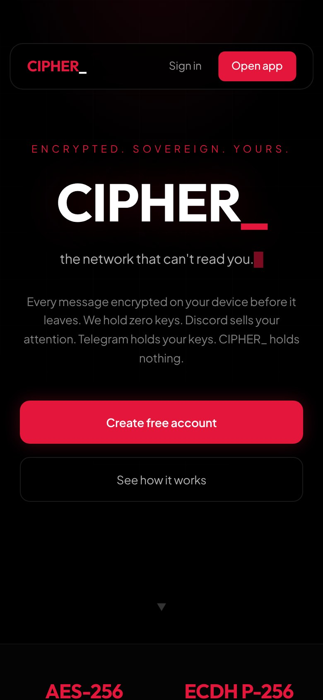
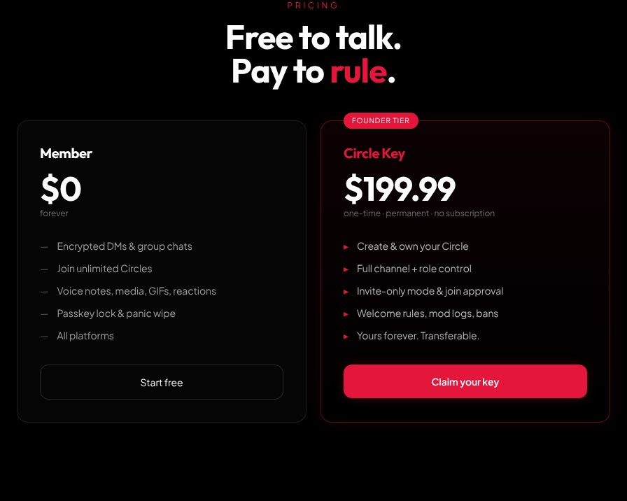

# CIPHER_ | Encrypted Messaging App

A private, end-to-end encrypted messaging app. Think Discord, except the server can't read a single message. Runs in the browser, installs as an app on iPhone and Android, and ships as a Windows desktop app.

**Live:** [cipher-swart-omega.vercel.app](https://cipher-swart-omega.vercel.app/)

> The source code is private because it's a paid product built around encryption. This repo shows what it is, what it does and how it's built.

## What it does

- **End-to-end encryption:** every DM, group chat and Circle message is encrypted on the device before it's sent. The server only stores ciphertext.
- **User-held keys:** the private key is generated on the device and never leaves it. Users can export it, back it up and import it on a new device.
- **Circles:** private encrypted servers with channels, roles, invite codes, join approval, welcome rules and moderation logs.
- **Lock screen and panic wipe:** 6 digit passkey with lockout after failed attempts, idle auto lock, and one command that erases everything.
- **Privacy modes:** Ghost Mode, Panic Mode, Smart Burn (self destructing messages) and an AES-256-GCM encrypted Vault.
- **Locked means locked:** a new device without the key shows a lock screen. No backdoor, no recovery team.
- **Hardened:** brute force lockouts, message rate limits, strict security headers and row level security on every database table.
- **Monetized:** free member accounts, plus a one time $199.99 Circle Key to create and own a Circle.

## Stack

| Layer | Tech |
|---|---|
| App | Next.js 15, React |
| Backend | Supabase (Postgres, Auth, Realtime, row level security) |
| Encryption | Client side ECDH P-256 key exchange, AES-256 message encryption |
| Desktop | Tauri (Windows .exe) |
| Mobile | Installable PWA (iPhone and Android) |
| Hosting | Vercel |

## Mobile

## Pricing page

## How it was built

I built CIPHER_ with AI (Claude and Claude Code) as a solo project: product design, database schema and SQL migrations, the encryption flow, the desktop build and the landing page.

---

Built by Ronald Lenser. [ronlenserdigital.com](https://www.ronlenserdigital.com) · [More of my work](https://ronaldlenser.github.io/)
